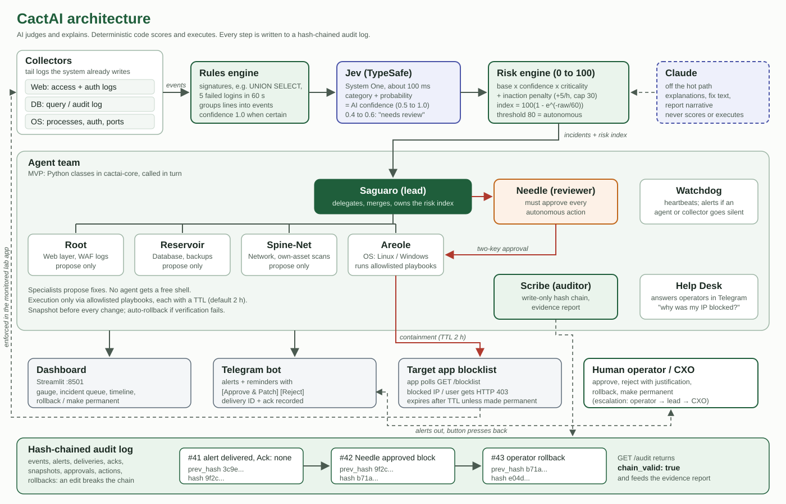

<h1><picture><source media="(prefers-color-scheme: dark)" srcset="assets/brand/logo-dark.svg"></picture></h1>

**An accountability-based security system for organizations that can't afford a security team.**

> *"A sentry doesn't chase you. It just guards the gate."*

SentrAI reads the logs you approve, turns what it sees into a live **0 to 100 risk index**, and when your own risk tolerance is crossed it applies a **temporary, reversible fix** inside your network and writes a tamper-evident **evidence report**. It never hacks back.

📘 **[Full install guide](https://rexguard.github.io/SentrAI/docs/)**, with screenshots, sign-in help, settings and troubleshooting. Calling SentrAI from your own tools: the **[API reference](https://rexguard.github.io/SentrAI/docs/api/)**.

## Install

### 1. What you need

| | Windows laptop | Linux or macOS laptop | Linux server |
| --- | --- | --- | --- |
| System | Windows 10 or 11 | any recent Linux, or macOS | Linux with systemd |
| Python | 3.12, on your PATH | 3.11 or newer, with `venv` | 3.10 or newer, with `venv` |
| Rights | your normal account | your normal account | `sudo` |
| Also | Git, or the ZIP from GitHub | Git | Git, plus `nft` or `iptables` to open the dashboard to other computers |

On Debian or Ubuntu: `sudo apt install python3-venv git`. No Docker needed: each part makes its own Python environment on first run, so the first start takes a minute or two longer.

### 2. Get the code

```bash
git clone https://github.com/RexGuard/SentrAI
cd SentrAI/mvp
```

No Git? On this page choose **Code**, then **Download ZIP**, unzip it and open the `mvp` folder. Every command below runs from `mvp`.

### 3a. Run it on your own computer

**Windows** (PowerShell, in the `mvp` folder):

```powershell
powershell -ExecutionPolicy Bypass -File .\run.ps1
```

**Linux or macOS:**

```bash
./run.sh
```

The first run asks a few setup questions; press **Enter** to keep the defaults. The classic dashboard opens at `http://127.0.0.1:8501`; for the web dashboard (the main console) run `web/run-web.sh` (`web\run-web.ps1` on Windows) and open `http://127.0.0.1:5173` and the console prints your **dashboard sign-in once**, so copy the password straight away. On Linux and macOS each part logs to `mvp/.run_logs/<part>.log`.

Stop everything with `.\stop.ps1` (Windows) or `./stop.sh`.

| Windows | Linux and macOS | What it does |
| --- | --- | --- |
| `-Speed 60` | `--speed 60` | runs the timers faster for a test (1 real minute = 1 hour). The default is real time |
| `-NoDashboard` | `--no-dashboard` | starts everything but the dashboard |
| `-NoBrowser` | `--no-browser` | does not open the browser |
| `-CorePort 8100` | `--core-port 8100` | when port 8000 is taken |
| `-DashboardPort 8601` | `--dashboard-port 8601` | when port 8501 is taken |

### 3b. Or install it on a Linux server

The installer sets SentrAI up as systemd services that start at boot, with HTTPS for the dashboard and a firewall rule so only the computers you name can reach it. Replace `203.0.113.10` with **your own computer's public IP** (the one you manage the server from):

```bash
sudo ./deploy/install.sh --protect 203.0.113.10 --admin-email you@example.com
```

It then asks for the dashboard port, allowed IPs, sign-in email and a password (press **Enter** to keep each default, or to have a password made for you). At the end it prints the dashboard address, `https://<your server>:8501`, and your sign-in. Your browser warns once about the self-made certificate; accept it and sign in.

| Option | What it does |
| --- | --- |
| `--protect IP` | never block this IP, and open the dashboard to it. Repeat for each address you manage from |
| `--admin-email EMAIL` | the dashboard sign-in email |
| `--dashboard-local` | keep the dashboard on the server only; reach it with `ssh -L 8501:127.0.0.1:8501 you@your-server` |
| `--dashboard-allow IP` | replace the list of IPs that can open the dashboard (when your own IP changes) |
| `--no-questions` (or `-y`) | never ask; use the options given and the defaults, for scripts |
| `--reset-password` | make a new dashboard password and print it |

**Update** with one command: `sudo sentrai-update`. It fetches the newest version, keeps every setting, sign-in and record, checks SentrAI still works and goes back to the old version by itself if not. The dashboard shows **Update available** when there is one. Remove it with `sudo ./deploy/uninstall.sh` (add `--purge` to also delete settings and records). All options are in the [server guide](https://rexguard.github.io/SentrAI/docs/server.html).

### 3c. Watch more machines from one panel

A server install can be the **central panel** for other machines. Add `--panel` to the install command (or run `sudo ./deploy/install.sh --panel` on an installed server): it opens port 8443 for agents, with HTTPS, and scores each machine on its own. Then, for each machine, press **Make join code** on the dashboard's **Machines** page and paste the command it shows on that machine, for example on Linux:

```bash
sudo ./mvp/deploy/install-agent.sh --panel https://panel.example.com:8443 --code ABCD-EFGH-JKLM --pin sha256:... --name web-01
```

Windows machines get a matching `install-agent.ps1` command. Agents update the same way as the panel: `sudo sentrai-update` (Windows: `& "C:\Program Files\SentrAI\update-agent.ps1"`). The agent sends that machine's logs to the panel and applies the panel's blocks for it, as a dry run until you rerun it with `--enforce`. It only makes outgoing HTTPS calls. Step by step: [One panel, many machines](https://rexguard.github.io/SentrAI/docs/panel.html).

### 4. Protect your own IP first

SentrAI never blocks the addresses in `PROTECTED_IPS`. Your own machine (`127.0.0.1`, `::1`) is always in it, and every `--protect` address is added on a server install. **Add the IP you manage from before you turn on any blocking**, or SentrAI could lock you out. Change it on the dashboard's **Configuration** page, or in `/etc/sentrai/sentrai.env` on a server (then `sudo systemctl restart sentrai.target`).

Those same addresses also tell SentrAI who you are. It keeps track of who is signed in on each machine: `sudo` commands from a `--protect` address (the installer writes them to `ADMIN_IPS`) (or any address, SSH key or account it knows as an administrator's) are recorded as your own work on the machine's **Admins** tab, while root work from a sign-in it does not recognise opens a **Root access from an unrecognised sign-in** alert that asks *was this you?* and blocks nothing on its own. Press **This was me** once and SentrAI learns that sign-in; or list your addresses, SSH key fingerprints or accounts in `ADMIN_IPS`, `ADMIN_SSH_KEYS` and `ADMIN_ACCOUNTS`. See [Your own administrators](https://rexguard.github.io/SentrAI/docs/settings.html#your-own-administrators).

### 5. Point it at your logs

SentrAI only reads the logs you approve. On the dashboard, open **Collector** and press **Scan running programs** to pick log files from the programs on the machine. On a Linux machine with nginx or SSH you can approve those in one step:

```bash
cd lab && .venv/bin/python -m collector.collector --add-system-logs
```

### 6. Decide how blocks take effect

Out of the box a block only goes on SentrAI's own blocklist (`/blocklist`, for your app or proxy to read). For blocks to stop traffic on their own, turn on one of:

- **Host firewall:** set `SENTRAI_FIREWALL=auto` (or `nftables`, `iptables`, `netsh` on Windows). It starts as a dry run that only logs the command it would run. When the commands look right, set `SENTRAI_FIREWALL_ENFORCE=1` (needs root or administrator rights).
- **Cloudflare:** save `CLOUDFLARE_API_TOKEN` and `CLOUDFLARE_ZONE_ID` (the Cloudflare extension) so each block also stops the attacker at Cloudflare's edge, and is removed there when it ends. See [Extensions](https://rexguard.github.io/SentrAI/docs/extensions.html).
- **Webhook:** set `SENTRAI_RESPONDER_WEBHOOK_URL` (and `SENTRAI_RESPONDER_WEBHOOK_SECRET`) so your own gateway, proxy or WAF applies each block and unblock.

See [Firewall blocking](https://rexguard.github.io/SentrAI/docs/settings.html#firewall-blocking) and the [full variable list](https://github.com/RexGuard/SentrAI/blob/main/mvp/README.md#variables).

### Something not working?

Port clashes, missing packages and a dashboard you can't reach are covered in [Troubleshooting](https://rexguard.github.io/SentrAI/docs/troubleshooting.html). Lost the dashboard password? Run `python sentrai_config.py admin --reset` in `mvp` (on a server, `sudo sentrai-admin --reset`).

## What it does

- **CIA + NA:** Confidentiality, Integrity, Availability, plus Non-repudiation and Authentication.
- **0 to 100 risk index** with an inaction penalty, so ignored alerts get louder over time.
- **AI categorization** with Jev (TypeSafe System One): typed answers and confidence in about 100 ms.
- **TTL hotpatches:** every automatic fix expires unless a human makes it permanent.
- **Hash-chained audit log** and security evidence report (Markdown, JSON, PDF).
- **Never hacks back:** it holds the line and never crosses it.



## More

- 📘 **[Install guide](https://rexguard.github.io/SentrAI/docs/)**: laptop, server, central panel, sign-in, settings, troubleshooting.
- 🔌 **[API reference](https://rexguard.github.io/SentrAI/docs/api/)**: every endpoint of the core with examples and error codes. The running core's own `/docs` page shows them live once you paste the API token.
- 🛠️ **[MVP README](https://github.com/RexGuard/SentrAI/blob/main/mvp/README.md)**: configuration, every variable, the parts and the tests. Server details in [deploy/README.md](https://github.com/RexGuard/SentrAI/blob/main/mvp/deploy/README.md).
- 📄 **[Full project plan](https://rexguard.github.io/SentrAI/Cybersecurity%20+%20AI.html)**: problem, data per layer, risk formula, Jev pipeline, hotpatch workflow, reports, ethics and stack. ([Markdown source](https://github.com/RexGuard/SentrAI/blob/main/Cybersecurity%20%2B%20AI.md))
- 🗺️ **[Roadmap](https://rexguard.github.io/SentrAI/ROADMAP.html)**: 9 phases from the MVP to a pilot.
- 🎬 [Video script](https://github.com/RexGuard/SentrAI/blob/main/mvp/pitch/VIDEO_SCRIPT.md), [slide outline](https://github.com/RexGuard/SentrAI/blob/main/mvp/pitch/SLIDES.md), [judge Q&A](https://github.com/RexGuard/SentrAI/blob/main/mvp/pitch/QA_PREP.md) and [sources](https://github.com/RexGuard/SentrAI/blob/main/mvp/research/SOURCES.md).

## Team

| Member | Role |
| --- | --- |
| Erick Sientaro | Developer |
| Ishmail | CEO |
| Hozen | Notetaker |

## Status

MVP working and tested on Windows and Linux, ready to install on real machines. Detection rules were first tuned on demo logs, so expect to adjust them on your own. 24-hour hackathon build: 2 to 3 Nov 2026.
