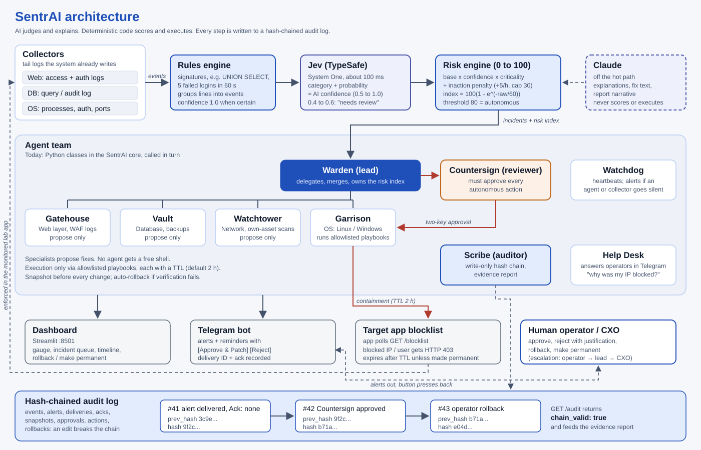

<h1><picture><source media="(prefers-color-scheme: dark)" srcset="assets/brand/logo-dark.svg"></picture></h1>

**A security guard for small organisations that can't afford a security team.**

> *"A sentry doesn't chase you. It just guards the gate."*

SentrAI reads the logs you approve, turns what it sees into a live **0 to 100 risk score**, and when your
own limit is crossed it applies a **temporary, reversible fix** inside your network (for example, blocking
an attacker's address for 2 hours) and writes a tamper-evident **evidence report**. It never hacks back.

The business owner gets one simple web page, the **SentrAI Cybersecurity Control Panel**, that says what
needs them in plain words. The SentrAI team does the setup and fine-tuning from the command line.

| | |
| --- | --- |
| ▶️ **Try it now, no install** | [Live panel demo](https://rexguard.github.io/SentrAI/demo-copy/#/command) + [attacker page](https://rexguard.github.io/SentrAI-demo/demo-site/attack.html) |
| 📘 **Install guide** | [rexguard.github.io/SentrAI/docs](https://rexguard.github.io/SentrAI/docs/) |
| 🔌 **API reference** | [rexguard.github.io/SentrAI/docs/api](https://rexguard.github.io/SentrAI/docs/api/) |
| 🧪 **Live attack lab** | [RexGuard/SentrAI-demo](https://github.com/RexGuard/SentrAI-demo) |

## Contents

1. [Try it in 2 minutes (no install)](#try-it-in-2-minutes-no-install)
2. [Run it on your computer (about 5 minutes)](#run-it-on-your-computer-about-5-minutes)
3. [What you will see](#what-you-will-see)
4. [Install it for real](#install-it-for-real)
5. [Who does what: owner panel and team command line](#who-does-what-owner-panel-and-team-command-line)
6. [How it works](#how-it-works)
7. [What is in this repository](#what-is-in-this-repository)
8. [More reading](#more-reading)

## Try it in 2 minutes (no install)

A copy of the real panel runs in your browser with made-up data, and a second page plays the attacker.
Nothing is really attacked: the attacker page replays a scripted password-guessing attack from a
documentation-only address (203.0.113.x).

1. Open the **panel**: <https://rexguard.github.io/SentrAI/demo-copy/#/command>
2. Open the **attacker page**, in another tab or on a second device such as your phone:
   <https://rexguard.github.io/SentrAI-demo/demo-site/attack.html>.
   Wait until it says **Connected to the SentrAI panel** (up to 5 seconds across devices).
3. Press **Launch simulated attack**. A Critical **Brute Force** risk appears in the panel's Command Center.
4. Open it and press **Do the suggested fix**. The attacker's screen shows it being blocked and giving up.
   Then try **Talk to Sentry about this** to ask the assistant what happened.

Two devices talk through a small public relay (ntfy.sh) in a "room", `solid10` by default. Type your own room
name on the attacker page if you want a private one; it then gives you the panel link to open.

## Run it on your computer (about 5 minutes)

### 1. You need

- **Python** 3.11 or newer (Windows: 3.12, on your PATH), with `venv`. On Debian or Ubuntu: `sudo apt install python3-venv git`
- **Git**, or the ZIP from GitHub (**Code**, then **Download ZIP**)
- **Node.js 20 or newer** for the web dashboard ([nodejs.org](https://nodejs.org)). Without it you still get the classic dashboard.

No Docker and no AI key are needed. Each part makes its own Python environment the first time it runs, so the
first start takes a minute or two longer.

### 2. Get the code

```bash
git clone https://github.com/RexGuard/SentrAI
cd SentrAI/mvp
```

Every command below runs from this `mvp` folder.

### 3. Start SentrAI

**Linux or macOS:**

```bash
./run.sh
```

**Windows** (PowerShell):

```powershell
powershell -ExecutionPolicy Bypass -File .\run.ps1
```

The first run asks a few setup questions: press **Enter** to keep each default. At the end it prints a
one-time **setup code**.

### 4. Open the web dashboard

In a second terminal, from the same `mvp` folder:

```bash
cd web && ./run-web.sh          # Windows: cd web; .\run-web.ps1
```

Open <http://127.0.0.1:5173>. On *Create your Owner account*, type the setup code, choose a password and
add an authenticator app. You are in. (The classic dashboard is also running at <http://127.0.0.1:8501>
and uses the same account.)

### 5. Make something happen

Your own computer is probably quiet, so use the **[SentrAI demo lab](https://github.com/RexGuard/SentrAI-demo)**.
It starts SentrAI next to a fake school portal and gives you buttons that send harmless attacks at it.
Stop the copy from step 3 first (`./stop.sh`), because the lab starts its own:

```bash
git clone https://github.com/RexGuard/SentrAI-demo
cd SentrAI-demo
./demo.sh            # Windows: .\demo.ps1
```

Then open <http://127.0.0.1:5000/lab> and press **Full story**. Watch the incidents open, the risk climb and
the attacker get blocked.

### 6. Stop

```bash
./stop.sh            # Windows: .\stop.ps1   (in mvp, or in SentrAI-demo for the lab)
```

On Linux and macOS each part logs to `mvp/.run_logs/<part>.log`. Port taken or a package missing? See
[Troubleshooting](https://rexguard.github.io/SentrAI/docs/troubleshooting.html).

| Option (Linux, macOS / Windows) | What it does |
| --- | --- |
| `--speed 60` / `-Speed 60` | timers run faster for a test (1 real minute = 1 hour) |
| `--no-browser` / `-NoBrowser` | do not open the browser |
| `--core-port 8100` / `-CorePort 8100` | when port 8000 is taken |
| `--dashboard-port 8601` / `-DashboardPort 8601` | when the classic dashboard's port 8501 is taken |

## What you will see

| Page | What it is for |
| --- | --- |
| **Command Center** | Start here. Critical, High and Medium risk cards: open one for a plain explanation, the suggested fix and quick actions (**Do the suggested fix**, **Not a threat**). Risks SentrAI already handled sit under *Already handled by SentrAI*, where each block can be undone |
| **Sentry** | The chat assistant. Ask "what happened last night?" or "is this serious?" and get a short, plain answer. Every risk has **Talk to Sentry about this** |
| **Computers** | Each machine SentrAI watches: its risk score (Low under 30, Medium 30 to 59, High 60 to 79, Critical 80 and up), shield status, packages and backups |
| **Activity Log** | Everything SentrAI and people did, in a hash-chained record nobody can quietly edit |
| **Setup** | One choice: **Strict**, **Moderate** or **Minimum** protection |
| **People and Access** | Owner, Admin and Auditor accounts, each with an authenticator app |

**Simple view** shows the same things in everyday words for a manager: *What Needs Me*, *Our Computers*,
*Reports to Share*, *Backups*, *Privacy and Staff Data*.

## Install it for real

| You want to | Do this | Guide |
| --- | --- | --- |
| Keep SentrAI running on a Linux server | `sudo ./deploy/install.sh --protect YOUR-IP --admin-email you@example.com` | [Install on a server](https://rexguard.github.io/SentrAI/docs/server.html) |
| Watch several machines from one panel | add `--panel`, then add each machine with a join code | [One panel, many machines](https://rexguard.github.io/SentrAI/docs/panel.html) |
| Update | `sudo sentrai-update` (keeps every setting and record, goes back by itself if a check fails) | [Update](https://rexguard.github.io/SentrAI/docs/server.html#update) |
| Remove | `sudo ./deploy/uninstall.sh` (`--purge` also deletes settings and records) | [Uninstall](https://rexguard.github.io/SentrAI/docs/server.html#uninstall) |

The short version for a server (Ubuntu 22.04 or 24.04 works well; install Node.js 20 or newer first for the
web dashboard):

```bash
git clone https://github.com/RexGuard/SentrAI && cd SentrAI/mvp
sudo ./deploy/install.sh --protect 203.0.113.10 --admin-email you@example.com --panel
```

Replace `203.0.113.10` with **the public IP you manage the server from**. SentrAI never blocks a protected
address, so this is what stops it locking you out. The installer prints the dashboard address
(`https://<your server>:8501`) and your sign-in. Then, for each extra machine, make a join code on the panel:

```bash
sudo sentrai machines join-code --name shop-pc     # prints the command to run on that machine
```

and paste the printed `install-agent.sh` (Linux) or `install-agent.ps1` (Windows) command on the new machine.
Agents only make outgoing HTTPS calls, and their blocks start as a dry run until you add `--enforce`.

How blocks take effect (host firewall, Cloudflare or your own webhook) is in
[Firewall blocking](https://rexguard.github.io/SentrAI/docs/settings.html#firewall-blocking). Which logs SentrAI
reads is in [Log sources](https://rexguard.github.io/SentrAI/docs/log-sources.html).

## Who does what: owner panel and team command line

SentrAI is built for a business owner with no IT team. So the web panel only shows what the owner needs
(what needs them, their computers, reports, backups), and **the SentrAI team does setup and tuning with the
`sentrai` command on the panel server**. Every command goes through the same API as the panel and is written
to the Activity Log.

```bash
sudo sentrai status                                   # protection, machines, what waits for a person
sudo sentrai settings preset moderate                 # strict | moderate | minimum
sudo sentrai settings set PROTECTED_IPS=203.0.113.10  # change any setting
sudo sentrai settings set TYPESAFE_API_KEY=...        # turns on Jev, the fast AI threat classifier
sudo sentrai settings set ANTHROPIC_API_KEY=...       # AI for Sentry's answers and planned fixes
sudo sentrai incidents list                           # approve, reject and roll back from here too
sudo sentrai backups key                              # the panel's recovery code: write it down, keep it elsewhere
sudo sentrai --help                                   # every command
```

All of it: [Team command line](https://rexguard.github.io/SentrAI/docs/cli.html). On a laptop, use
`python sentrai_config.py setup` in `mvp` instead.

## How it works



1. **Collect.** The collector (or an agent on each machine) reads only the log files you approve: web
   server, SSH, Windows Event Log, databases, Suricata.
2. **Recognise.** Rules spot known attacks (password guessing, SQL injection, data theft, web shells). An
   optional AI step, **Jev** (TypeSafe System One), labels what the rules miss, with keyword matching as
   the last fallback.
3. **Score.** Each machine gets a 0 to 100 risk score. Ignored alerts get louder over time.
4. **Act, reversibly.** Above your limit SentrAI blocks the attacker's address or locks the account for a set
   time (2 hours by default, 24 hours at most). Below it, a person decides with one press. Every fix can be
   undone, and protected addresses are never touched.
5. **Explain.** Sentry answers questions in plain words. Each incident gets an evidence report (Markdown,
   JSON, PDF) and a line in the hash-chained Activity Log.
6. **Recover.** Backups are locked with a key and copied to two other joined machines, so a lost machine
   (even the panel) can be brought back.

SentrAI works with no AI key at all: the rules decide on their own. With a key, Sentry and the AI responder use
Claude (Anthropic); OpenAI, DeepSeek or any OpenAI-compatible model also work.

**What SentrAI never does:** attack back, scan other people's networks, or act outside the machines you gave it.
*It holds the line and never crosses it.*

## What is in this repository

```
mvp/                    the product
  run.sh, run.ps1       start everything on one computer      stop.sh, stop.ps1   stop it
  core/                 risk scoring, decisions, blocks, Sentry chat, audit log (FastAPI, :8000)
  lab/                  the collector that reads approved logs, and Scout, which finds log files
  web/                  the web dashboard (React, Vite, Tailwind)   web/run-web.sh -> :5173
  dashboard/            the classic dashboard (Streamlit, :8501), kept as a fallback
  notifier/             Telegram and email alerts with Approve and Reject buttons
  deploy/               server installer, agent installers, sentrai-update, systemd units
  sentrai_cli.py        the team's `sentrai` command
  extensions/           optional add-ons: Cloudflare, AbuseIPDB, Slack, Telegram, TypeSafe
  eval/                 detection accuracy and Sentry answer checks
docs/                   the install guide and API reference (the website)
demo-copy/              the browser-only copy of the panel used by the live demo
Cybersecurity + AI.md   the full project plan
ROADMAP.md              from the MVP to a pilot
```

Tests: after a first `./run.sh`, run `cd core && .venv/bin/python -m pytest -q` in `mvp` (and the same in
`lab`, `dashboard` and `notifier`). Every variable, part and test is in
[mvp/README.md](https://github.com/RexGuard/SentrAI/blob/main/mvp/README.md).

## More reading

- 📘 **[Install guide](https://rexguard.github.io/SentrAI/docs/)**: laptop, server, central panel, log sources, sign-in, settings, team command line, troubleshooting.
- 🔌 **[API reference](https://rexguard.github.io/SentrAI/docs/api/)**: every endpoint of the core with examples.
- 🛠️ **[MVP README](https://github.com/RexGuard/SentrAI/blob/main/mvp/README.md)** and **[server README](https://github.com/RexGuard/SentrAI/blob/main/mvp/deploy/README.md)**: every variable and file.
- 📄 **[Full project plan](https://rexguard.github.io/SentrAI/Cybersecurity%20+%20AI.html)**: problem, data per layer, risk formula, Jev pipeline, fix workflow, reports, ethics and stack ([Markdown source](https://github.com/RexGuard/SentrAI/blob/main/Cybersecurity%20%2B%20AI.md)).
- 🛡️ **[Responsible AI and risk statement](https://rexguard.github.io/SentrAI/docs/responsible-ai.html)**: which AI is used, what data it sees, known risks, and every AI tool, model and asset used to build SentrAI.
- 🗺️ **[Roadmap](https://rexguard.github.io/SentrAI/ROADMAP.html)**: 9 phases from the MVP to a pilot.
- 📚 [Sources](https://github.com/RexGuard/SentrAI/blob/main/mvp/research/SOURCES.md) for the facts and figures we quote.

## Team

The people building SentrAI:

| Member | Role |
| --- | --- |
| Erick Sientaro | Developer |
| Ishmail | CEO |
| Hozen | Notetaker |

## Status

Working prototype, tested on Windows and on Ubuntu servers, with agents for Linux and Windows (no macOS agent
yet). Detection rules were first tuned on demo logs, so expect to adjust them for your own machines. Only
blocking an address and locking an account change anything for real; other fix types are recorded, or passed
to your own gateway through a webhook.
